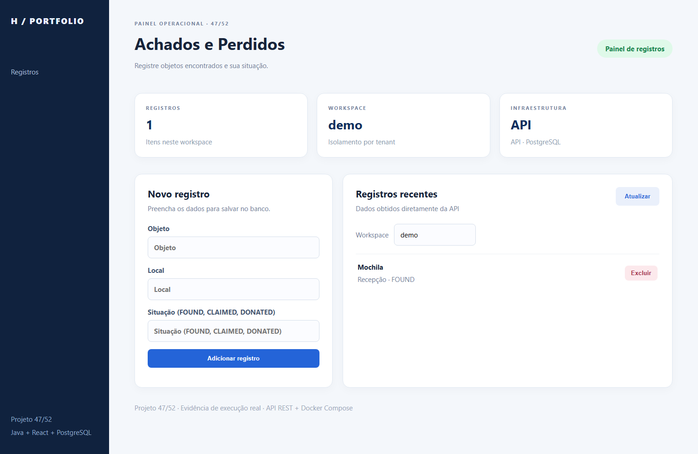

# Achados e Perdidos

Projeto 47/52 — Registre objetos encontrados e sua situação.

## Stack
Java 25, Spring Boot, PostgreSQL 17, Flyway, React 19, esbuild, Docker Compose, Playwright.

## API
- `GET /api/health` — saúde da API
- `GET /api/entries` — listar registros
- `POST /api/entries` — criar registro (`item, place, state` obrigatórios)
- `DELETE /api/entries/{id}` — excluir registro

O cabeçalho `X-Tenant` identifica um workspace demonstrativo, **não é autenticação nem isolamento seguro entre usuários**.

## Evidência real

A imagem é criada pelo script de publicação somente após o frontend e a API responderem, com um registro persistido.

## Execução
`cd frontend; npm install --package-lock-only; cd ..` (primeira execução)

`docker network create --subnet 10.253.47.0/28 portfolio47_default` (somente se a rede ainda não existir e a sub-rede estiver livre; o script verifica conflitos automaticamente).

`docker compose up -d --build`

Frontend: http://localhost:5207 | API: http://localhost:8217/api/health

## Critérios de conclusão do MVP
Build Java e frontend, PostgreSQL saudável, GET/POST/DELETE funcionando, screenshot real versionado, push público e CI concluída com sucesso.

## Limites do MVP
Registro CRUD por workspace demonstrativo. Sem autenticação, notificações automáticas ou integrações externas.
